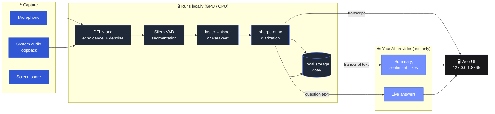

<div align="center">

<picture>
  <source media="(prefers-color-scheme: dark)" srcset="brand/kit/murmur-horizontal-white.svg">
  
</picture>

### Your meetings, transcribed on your own machine. Your interviews, answered live.

A local, **bot‑free** meeting notetaker and live interview copilot for Windows.<br>
Records your mic **and** your computer audio, transcribes and separates speakers on your GPU,<br>
then writes the notes, or drafts your answer while the question is still being asked.

<br>

[](https://www.python.org/)
[](#-requirements)
[](https://fastapi.tiangolo.com/)
[](#-requirements)
[](LICENSE)

[](#-models)
[](#-models)
[](#-models)
[](#-ai-providers)
[](#-ai-providers)
[](#-ai-providers)
[](#-contributing)

<br>

[**Quick start**](#-quick-start) ·
[**Features**](#-features) ·
[**How it works**](#-how-it-works) ·
[**Models**](#-models) ·
[**Privacy**](#-privacy) ·
[**Desktop build**](#-windows-desktop-app--installer) ·
[**Contributing**](#-contributing)

</div>

---

## ✨ Why Murmur

<table>
<tr>
<td width="33%" valign="top">

### 🤫 No bot in the call
Murmur listens to your own devices: microphone plus system loopback. Zoom, Teams, Meet, Slack huddles, a browser tab: if you can hear it, it can transcribe it. Nobody gets a "Notetaker has joined" message.

</td>
<td width="33%" valign="top">

### 🔒 Audio stays local
Recognition, speaker separation, voice activity detection and echo cancellation run on your machine. Only **text** goes to the AI provider you pick, and only for summaries and Copilot answers.

</td>
<td width="33%" valign="top">

### ⚡ Answers in ~1–2 s
In Copilot mode the other side's question is detected automatically, and the first words of your answer appear about one to two seconds later, grounded in your own resume and documents.

</td>
</tr>
</table>

## 🎛️ Two modes, one app

Switch between them from the header at any time.

| | 📝 **Notetaker** | 🎯 **Copilot** |
|---|---|---|
| **For** | Meetings, calls, lectures, imported recordings | Job interviews and live calls |
| **During the call** | Live draft transcript with speakers | Detects questions, writes your answer in real time |
| **After the call** | Re‑transcribes at high accuracy, AI summary, sentiment, speaker stats | Full session with every question and answer kept |
| **Input** | Mic + system audio, screen capture, audio/video import | Mic + system audio, screenshots, resume, documents, playbook |
| **Output** | TXT · SRT · Markdown | A readable session log you can revisit |

## 🚀 Features

<details open>
<summary><b>📝 Notetaker mode</b></summary>
<br>

- **Record** mic and computer audio together, no bot in the call. Switch the mic mid‑recording without stopping; mute either source live.
- **Screen capture**: hit **Share screen** at any point (screen, window or tab). The video is placed at the second it started and stays in sync with the audio on playback.
- **Refine after recording**: the live transcript is a draft. When the meeting ends, the saved audio is re‑transcribed with slower, more accurate settings and replaces it. The summary pass also fixes clearly misheard lines (dotted underline, hover to see the original).
- **Speakers**: every voice is separated (Speaker 1, 2, 3…), including two people sharing one mic. Names are picked up from self‑introductions; rename a speaker in the transcript, or give two speakers the same name to merge them.
- **Insight tabs**: *Overview* (AI summary), *Sentiment* (positive / neutral / negative per sentence, filterable) and *Speakers* (talk time, word count, re‑diarize with a chosen speaker count).
- **Player**: click any word to seek, 1× / 1.5× / 2×, and a now‑playing bar that follows you across meetings.
- **AI summary**: short summary, topics, decisions, action items and open questions, written in the meeting's language.
- **Import** an `mp3 / m4a / wav / mp4 / mkv …` file and transcribe it directly.
- **Export** to TXT, SRT or Markdown.
- **Echo filter** removes speaker bleed when you use speakers instead of headphones.

</details>

<details open>
<summary><b>🎯 Copilot mode (interview and call assistant)</b></summary>
<br>

- **Sessions**: create one per call with company, role and job description. Paste a job link to fill it in automatically. Choose language, AI model and answer style (format, length, tone, STAR, fillers); your last choices are remembered.
- **Resumes & documents**: upload your CV and notes as PDF, Word or text, or paste them. Answers come **only** from these, the job description and your playbook. The prompt forbids inventing employers, numbers or projects.
- **Live answers**: questions are detected automatically and answered in a natural, spoken style with a concrete example from your experience. Press **Answer** (or <kbd>Space</kbd>) to answer the last question on demand, or type your own.
- **Screenshot**: send what's on your shared screen (a coding task, a diagram) to the AI together with the last ten messages and the previous screenshot; it solves the task in context.
- **Low latency**: a warm‑up request and a speculative start put the first words on screen ~1–2 s after the question, with the full answer in about 3 s.
- **Interview playbook**: [`tools/build_playbook.py`](tools/build_playbook.py) turns your past interview transcripts into a playbook (proven self‑intro, facts, stories, Q&A, phrasings) that every answer draws on.

</details>

## 🧠 How it works



A **FastAPI + uvicorn** backend on `127.0.0.1:8765` serves a vanilla‑JS frontend and streams the live transcript and answers over a **WebSocket**. Audio capture, resampling (soxr), VAD, recognition, diarization and echo cancellation all run in‑process. The design decisions, tuning and latency benchmarks are recorded in [`docs/adr-001-audio-pipeline.md`](docs/adr-001-audio-pipeline.md).

## 🏁 Quick start

### ✅ Requirements

| | |
|---|---|
| 🪟 **OS** | Windows 10 or 11 (system audio is captured through WASAPI loopback) |
| 🐍 **Python** | 3.12 |
| 🟩 **GPU** | NVIDIA GPU recommended for fast Whisper; falls back to CPU |
| 🎞️ **ffmpeg** | `ffmpeg.exe` in `bin/` (not tracked in git, see below) |
| 🔑 **API key** | One of Anthropic, OpenAI or NVIDIA, for summaries and Copilot answers |

### 1 · Get the code

```bash
git clone https://github.com/muradiodev/murmur-notetaker-copilot.git
cd murmur-notetaker-copilot
```

Download a static Windows build of [ffmpeg](https://www.gyan.dev/ffmpeg/builds/) and put `ffmpeg.exe` into `bin/`.

### 2 · Install (one click)

| Script | What it does |
|---|---|
| `setup.bat` | First run only: creates the virtual env, installs dependencies, downloads the models |
| `run.bat` | Starts the app at **http://127.0.0.1:8765**. Closing the window stops it |

<details>
<summary>…or do it by hand</summary>

```bat
python -m venv .venv
.venv\Scripts\python -m pip install -r requirements.txt
.venv\Scripts\python -m app.setup_models     REM downloads models on first run
.venv\Scripts\python -m app.server           REM serves http://127.0.0.1:8765
```

</details>

### 3 · Add a key

Open **Settings** (bottom left) → **API keys**, paste a key and choose a **Summary provider**. Settings, keys included, are saved to `data/settings.json` and survive restarts.

> [!TIP]
> Want to see what a finished Copilot session looks like before your first call?
> `python tools/demo_copilot.py` creates four demo sessions with a fictional candidate; `--remove` deletes them again.

## 🤖 AI providers

| Provider | Used for | Notes |
|---|---|---|
|  **Anthropic Claude** | Summaries, Copilot answers | Haiku, Sonnet or Opus |
|  **OpenAI** | Summaries, Copilot answers | Model list is read from your own account |
|  **NVIDIA NIM** | Summaries, Copilot answers | Model list is read from your own account |

Every provider has a **Test** button that checks the selected model responds before you rely on it in a call.

## 📦 Models

All speech models run locally and live in `models/` (not tracked in git). [`app/setup_models.py`](app/setup_models.py) downloads what's missing on first run.

| Folder | Model | Role |
|---|---|---|
| `faster-whisper/large-v3-turbo` | Whisper large‑v3‑turbo (CTranslate2) | 🗣️ Default recognition, multilingual, GPU |
| `parakeet-tdt-0.6b-v3-onnx` | NVIDIA Parakeet TDT 0.6B v3 (ONNX int8) | ⚡ Optional engine, DE/EN, fast on CPU |
| `diarization/` | pyannote segmentation 3.0 + WeSpeaker ResNet34 (sherpa‑onnx) | 👥 Speaker separation |
| `silero_vad.onnx` | Silero VAD | 🎚️ Voice activity and segmentation |
| `aec/` | DTLN‑aec (ONNX) | 🔇 Echo cancellation and denoise |

## 🗂️ Project structure

```text
murmur-notetaker-copilot/
├── app/                  # backend
│   ├── server.py         #   FastAPI app, REST + WebSocket
│   ├── audio.py          #   mic + loopback capture, resampling
│   ├── transcriber.py    #   faster-whisper / Parakeet engines
│   ├── diarize.py        #   speaker separation (sherpa-onnx)
│   ├── aec.py, dtln.py   #   echo cancellation
│   ├── summary.py        #   AI summaries, sentiment, provider clients
│   ├── copilot.py        #   live interview answers, resume/document library
│   ├── names.py          #   speaker names from self-introductions
│   ├── storage.py        #   meetings on disk, exports
│   └── static/           # frontend: index.html, app.js, copilot.js, style.css, i18n/
├── tools/                # build_playbook.py, demo_copilot.py
├── packaging/            # PyInstaller + Inno Setup desktop build
├── docs/                 # architecture decision records
├── brand/                # logo and brand kit
├── desktop.py            # WebView2 desktop window
├── setup.bat · run.bat
└── models/ · data/       # local models and user data (git-ignored)
```

## 🪟 Windows desktop app & installer

A packaged build with its own window (WebView2) and a `setup.exe` installer:

```powershell
powershell -ExecutionPolicy Bypass -File packaging\build.ps1
```

Requirements and caveats are in [`packaging/README.md`](packaging/README.md).

## 🔐 Privacy

| Stays on your machine | Sent to your AI provider |
|---|---|
| 🎙️ Raw audio and screen recordings | 📝 Transcript text, for summaries |
| 🗣️ Transcription and speaker separation | ❓ Question and conversation text, for Copilot answers |
| 🔑 API keys (`data/settings.json`) | 🖼️ Screenshots, only when you press **Screenshot** |
| 📄 Your resumes, documents and playbook library | 📄 The resume and documents you attach to a Copilot session |

> [!IMPORTANT]
> `data/` and `models/` are git‑ignored. Never commit `data/settings.json`: it holds your API keys.

## 🤝 Contributing

Issues and pull requests are welcome.

1. Fork the repo and create a branch: `git checkout -b feature/my-change`
2. Keep changes focused, and match the style of the surrounding code
3. Run the app and check the change in both modes
4. Open a pull request describing what changed and why

UI strings live in [`app/static/i18n/en.js`](app/static/i18n/en.js), so adding a language starts there.

## 🙏 Built on

[faster‑whisper](https://github.com/SYSTRAN/faster-whisper) ·
[sherpa‑onnx](https://github.com/k2-fsa/sherpa-onnx) ·
[pyannote](https://github.com/pyannote/pyannote-audio) ·
[WeSpeaker](https://github.com/wenet-e2e/wespeaker) ·
[Silero VAD](https://github.com/snakers4/silero-vad) ·
[DTLN‑aec](https://github.com/breizhn/DTLN-aec) ·
[NVIDIA Parakeet](https://huggingface.co/nvidia/parakeet-tdt-0.6b-v3) ·
[onnx‑asr](https://github.com/istupakov/onnx-asr) ·
[FastAPI](https://fastapi.tiangolo.com/) ·
[Geist](https://vercel.com/font) ·
[Phosphor Icons](https://phosphoricons.com/)

## 📄 License

Released under the [MIT License](LICENSE). Third‑party models keep their own licenses; check each model's page before redistributing them.

> [!NOTE]
> Copilot is an interview‑preparation and live‑assistance tool. Use it in line with the rules of any interview or assessment you take part in, and let people know when you record a conversation where the law requires it.

<div align="center">
<br>

<br>
<sub>Made with 🎧 for people who'd rather listen than take notes.</sub>
</div>
